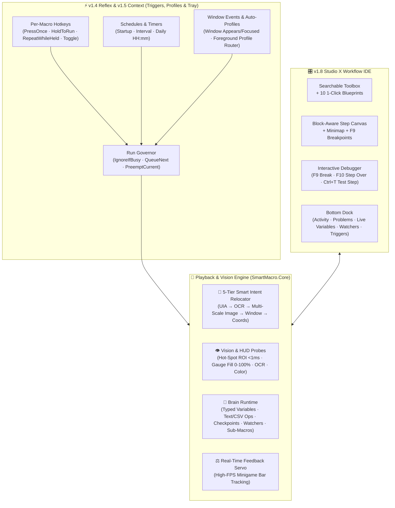

# SmartMacro

**All-round AAA desktop & game macro studio for Windows — record, build, debug, and automate workflows visually.**

Owner & developer: **Riku** · Version **1.8.0 ("Studio X")** · `.NET 10` (WPF, `win-x64`)

SmartMacro is a local-first Windows automation studio designed for both **daily productivity ("Workbench")** and **gaming ("Arena")**. It records mouse and keyboard input across desktop apps and 3D games, turns recordings into structured visual workflows, and provides computer vision (template matching, pixel color, HUD gauge % reading, Windows OCR), branching logic, typed variables, background watchers, per-macro triggers, and an interactive step debugger — all with **zero scripting required** and **zero cloud uploads**.

---

## System Architecture



---

## Key Capabilities

### 1. 🧭 Smart Dual-Stream Recording & 5-Tier Intent Relocator (`v1.0`–`v1.1 "Intent"`)
- **One Record button for apps and games:** SmartMacro records screen coordinates and raw relative mouse movement simultaneously on one timeline. Free-cursor segments become editable **Move / Click / Key / Delay** steps; locked/hidden-cursor camera turns become **Recorded input** steps with automatic stuck-key protection.
- **5-Tier Resilient Target Relocator:** When **Intent Recording** is enabled, recorded clicks capture a multi-anchor fingerprint off-thread and relocate automatically if windows move or resize:
  1. **UI Automation element** (`AutomationId`, `Name`, `ControlType`, normalized interior click point)
  2. **Nearby OCR text anchor** + pixel offset
  3. **56×56 Image Snapshot** (1:1 fast path + **75%–150% multi-scale pyramid** for DPI/zoom changes)
  4. **Window-Relative coordinate anchor**
  5. **Recorded coordinates fallback**
- **🩹 Opt-in Smart Self-Heal:** When playback relocates a drifted click by `≥ 25 px`, the editor offers a 1-click banner to update the step's coordinates (`Ctrl+Z` undoes it; macros are never rewritten silently).
- **⏱ Adaptive Timing & 🎲 Humanize:** Delay steps can wait a fixed duration, **Until screen settles** (continues early once loading animations stop), or **Until screen changes** (continues the instant new pixels appear). Optional **Humanize** adds subtle click jitter (kept inside matched bounds), natural delay variation, and curved mouse glides.

### 2. 🧠 Brain: Variables, Checkpoints, Watchers & Sub-Macros (`v1.2 "Brain"`)
- **Typed Variables & `{placeholders}`:** Declare `Number`, `Text`, or `Boolean` variables with live runtime values in the bottom dock. Use `{varName}` inside **Type text**, **Find text**, **Focus window**, or **Screenshot** steps.
- **Screen & List Data Sources:** Set, add, subtract, or transform variables from constants, **🔢 Read number on screen (OCR)**, **Read text on screen**, **📊 Read bar / gauge fill % (`0–100%`)**, **Clipboard**, **Last found X/Y**, **Loop counter**, **Elapsed seconds**, or **📋 Item from list variable (at loop turn)**.
- **📍 Checkpoints & Per-Step Failure Policies:** On any vision search or window focus timeout, choose to **Continue**, **Skip next step**, **Stop**, **🔁 Retry (`N` extra attempts)**, **🛡 Run a recovery sub-macro**, or **📍 Jump back to a Checkpoint** (capped at 25 restarts per run).
- **🛡 Background Watchers:** Periodic interrupt guards checked between steps (with configurable interval and cooldown) to dismiss surprise popups, run recovery sub-macros, or jump to a checkpoint.
- **📦 Sub-Macros & Self-Contained `.smacro` Bundles:** Call reusable library macros with isolated variable memory and Input/Output parameter bindings. Static and runtime call-graph validation prevents recursion cycles. Exporting from the Library automatically bundles all transitive sub-macros into a single `.smacro` file.

### 3. ⚡ Reflex: Per-Macro Triggers & Run Governor (`v1.4 "Reflex"`)
- **4 Per-Macro Hotkey Modes:** Attach hotkeys directly to any macro in the **⚡ Triggers** dock:
  - **Press once to run**
  - **Hold to run (stop when released)**
  - **Repeat while held (loop until released)**
  - **Toggle start / stop**
- **Schedules & Window Event Triggers:** Trigger macros **On app startup**, **Every N seconds**, **Daily at `HH:mm`**, or when a matching **Window appears / gains focus**.
- **Run Governor & Master Armed Switch:** Configure per-trigger conflict handling (**Ignore if busy**, **Queue next** up to 8 runs, or **Preempt & stop current**) and toggle all background triggers with the top-bar **⚡ Triggers Armed** pill.

### 4. 🗂 Context: App/Game Profiles & System Tray Resident Mode (`v1.5 "Context"`)
- **Profiles & Foreground Auto-Switching:** Tag macros with a profile (`Work`, `Excel`, `Elden Ring`, etc.) and filter by profile pill in the Library. Enable **Auto-switch active profile from foreground window** in Settings so profile-scoped triggers only fire when their target app or game is in front (while global macros stay active everywhere).
- **Resident System Tray Mode:** Enable **Minimize to system tray when closing the main window** to keep triggers armed silently in the background with a tray icon and quick context menu (**Stop All**, **Pause / Resume**, **Triggers Armed**, **Open Studio**).

### 5. 📊 Eyes, Arena & Workbench Upgrades (`v1.6 "Eyes"` + `v1.7 "Workbench + Arena"`)
- **HUD Bar & Progress Gauge Reader (`0–100%`):** Measures horizontal (`LeftToRight`, `RightToLeft`) and vertical (`BottomToTop`, `TopToBottom`) health, mana, stamina, or progress bars by fill color and tolerance — automatically filtering out centered text overlays (`100/100`) and scaling cleanly across `1080p`, `1440p`, and `4K` via `RelativeRect`.
- **Hot-Spot ROI Turbo (`< 1 ms`):** Image searches remember where their template was last seen and check a `±24 px` neighborhood first in under a millisecond before falling back to a full-area scan.
- **Workbench Text Cleanup & Window Snap:** Clean up scraped or clipboard text with **Trim whitespace**, **Extract digits only**, **UPPERCASE**, and **lowercase** operations, iterate over CSV/multi-line lists with `LineAtLoopIndex`, and snap target windows (`SnapLeftHalf`, `SnapRightHalf`, `Maximize`, `CenterOnPrimary`) via **Focus window**.

### 6. 🎛 Studio X: 3-Pane IDE & Interactive Debugger (`v1.8 "Studio X"`)
- **3-Pane Studio Workspace:** Searchable Toolbox with instant filtering, block-indented Workflow Canvas with color-coded guide rails and right-edge **Workflow Minimap**, sticky **Inspector**, and `Ctrl+K` **Command Palette**.
- **🔴 Interactive Step Debugger (`F9` / `F10`):**
  - Press **`F9`** (or click **🔴 Break**) on any step to toggle a breakpoint badge (`🔴 BREAK`).
  - When playback hits a breakpoint, it pauses right before executing that step, safely releases held keys/buttons, and highlights the step.
  - Inspect live variable values in the **🧠 Variables** dock, press **`F10`** (**⏭ Step**) to execute one step and pause before the next, or press **`F8`** to resume normal speed.
- **🧪 Instant Vision Testing (`Ctrl+T`):** Test any Find Image / Color / Text step or `If`/`Repeat` condition against the live screen without running the macro — flashes a green reticle on a match or an amber reticle on the closest near-miss with its similarity score.
- **10 1-Click Blueprints & Searchable Studio Manual:** Load complete starter workflows (including **Arena Auto-Potion / Gauge Guard**, **Arena Skill Priority Rotation**, **Workbench List / Row Loop**, **Screen Counter Goal Loop**, and **Checkpoint & Retry Recovery Flow**) with a single click.

---

## Keyboard Shortcuts

| Shortcut | Action | Scope |
| :--- | :--- | :--- |
| `Ctrl+Shift+F9` *(customizable)* | Start / stop recording | Global (anywhere) |
| `Ctrl+Shift+F10` *(customizable)* | Play macro / stop playback | Global (anywhere) |
| `F8` *(customizable)* | Pause / resume playback (releases held keys while paused) | Global while playing |
| `Esc` | Emergency stop (releases all held keys and buttons immediately) | Global while playing |
| `F9` | 🔴 Toggle debugger breakpoint on selected step | Editor |
| `F10` | ⏭ Step over: run one step while paused and pause before the next | Editor / While paused |
| `Ctrl+T` | 🧪 Test Step: test vision detection once (with near-miss score) or run action step once | Editor |
| `Ctrl+F5` | ▶ Run step: play only the selected step (or whole `If` / `Repeat` block) | Editor |
| `Shift+F5` | ⏭ Play from the selected step to the end | Editor |
| `Ctrl+K` | Open Command Palette (add steps, blueprints, play, auto-fix, speed…) | Editor |
| `Ctrl+F` | Search steps in workflow (`F3` / `Shift+F3` next/previous match) | Editor |
| `Ctrl+S` | Save workflow | Editor |
| `Ctrl+Z` / `Ctrl+Y` | Undo / Redo (`Ctrl+Shift+Z` also redoes) | Editor |
| `Ctrl+C` / `Ctrl+V` / `Ctrl+D` | Block-aware Copy / Paste / Duplicate | Step list |
| `Space` | Enable / disable selected steps (or whole `If` / `Repeat` block) | Step list |
| `←` / `→` | Fold / unfold selected `If` / `Repeat` block | Step list |
| `Alt+↑` / `Alt+↓` | Block-aware move step up / down (`Alt+Home` / `Alt+End` for top / bottom) | Step list |
| `Ctrl+Shift+I` / `Ctrl+Shift+R` | Wrap selected steps in `If … End If` / `Repeat … End Repeat` | Step list |

---

## Requirements & Installation

- **OS:** Windows 10 version 2004 (May 2020 Update) or newer, or Windows 11 (`x64`).
- **OCR:** Uses the Windows built-in OCR engine (`Windows.Media.Ocr`). Check **Settings → Text recognition** in SmartMacro to verify your display language's OCR pack is installed.
- **Data location:** Macros, settings, logs, and crash diagnostics are stored locally in `%LOCALAPPDATA%\SmartMacro` (never inside the application folder, so upgrading preserves your library).

### Build, Verify & Package from Source

Requires the **.NET 10 SDK** on Windows:

```powershell
# Build with -warnaserror and run all 1,235 unit tests (logs written to artifacts\build.log & artifacts\test.log)
cmd /c tools\verify.cmd

# Run tests, publish a self-contained single-file win-x64 EXE, verify notices, and create the release ZIP
tools\publish.cmd
```

---

## Safety & Honest Limits

- **Emergency Stop & Stuck-Key Failsafe:** Pressing physical `Esc` stops playback immediately. Every key and mouse button pressed by SmartMacro is tracked and released when playback finishes, stops, pauses, or if an error occurs.
- **Administrator Apps (UIPI):** Windows blocks normal processes from sending input to elevated (Run as Administrator) windows, the lock screen, or UAC prompts. Run SmartMacro as Administrator if your target game or app runs as Administrator.
- **Exclusive Fullscreen:** GDI screen capture sees black in exclusive fullscreen games; switch the game to **Borderless Windowed** or **Windowed** mode for vision steps.
- **Anti-Cheat:** SmartMacro uses standard Win32 input and screen capture APIs (`SendInput`, `BitBlt`, `Windows.Media.Ocr`, `UIAutomation`) and never reads game memory or attempts to bypass anti-cheat software.

---

© 2026 Riku
