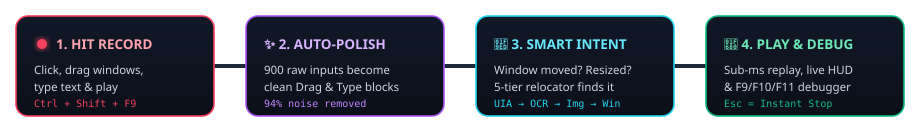
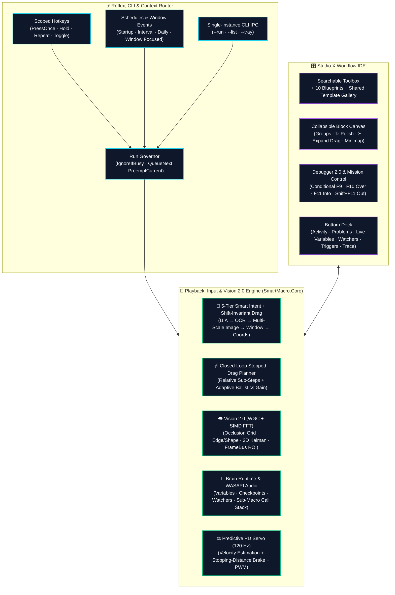

<div align="center">


<br />

[-0ea5e9?style=for-the-badge&logo=windows&logoColor=white)](https://github.com)
[](https://dotnet.microsoft.com)
[](https://github.com)
[](tools/verify.cmd)
[](#requirements--installation)


**The local-first Windows automation studio built for any game (*Arena*) and daily desktop power workflows (*Workbench*).**

Developer: **Riku (リク)** · Studio: **KuroLogic** · Built with `.NET 10` (`WPF`, `win-x64`)

[**Why SmartMacro?**](#why-smartmacro-studio) · [**Showdown**](#old-school-macro-vs-smartmacro-studio) · [**Visual Tour**](#visual-tour) · [**Quick Start**](#30-second-quick-start) · [**Pick Your Quest**](#pick-your-quest-interactive-recipes) · [**Superpowers**](#core-superpowers) · [**Shortcuts**](#keyboard-shortcuts)

</div>

<p align="center">
  
</p>

## Why SmartMacro Studio?

Let's be honest — traditional macro tools force you to choose between **two kinds of pain**:
- **🪤 Dumb Coordinate Recorders:** They work great for 5 minutes… until you nudge a window 10 pixels to the left, a loading spinner lags by half a second, or you try to drag a window across the screen and watch the cursor teleport while the window sits there mocking you.
- **📜 200-Line Scripting Engines:** Want to find a button, read a number, and loop? Congratulations, you're now debugging regex and Win32 handles at 2 AM.

**SmartMacro Studio** is the cure: **1-click recording** that automatically cleans up your messy input into visual workflow blocks — powered by **GPU screen capture**, **5-tier self-healing target relocation**, **smart minigame physics**, and a **real call-stack debugger**.

<table>
  <tr>
    <td width="50%" valign="top">
      <h3>🎮 Mode 1: The Arena (Any Game &amp; Minigames)</h3>
      <ul>
        <li><strong>Dual-Stream Recording:</strong> Seamlessly mixes 2D inventory/menu clicks with camera turns (<code>WM_INPUT</code>) on a single sub-millisecond timeline across any game genre.</li>
        <li><strong>Predictive PD Minigame Servo (120 Hz):</strong> Tames wild momentum/gravity minigame bars with real-time velocity estimation, stopping-distance braking, and PWM hover pulses.</li>
        <li><strong>Vision 2.0 + SIMD FFT:</strong> Spots moving or 40%-occluded targets right through visual effects, tracks them with a 2D Kalman filter, and leads clicks ahead of motion.</li>
        <li><strong>Zero-Stuck-Key Guarantee:</strong> Physical <kbd>Esc</kbd> emergency stop + <code>HeldInputTracker</code> guarantees no key or mouse button is ever left held down.</li>
      </ul>
    </td>
    <td width="50%" valign="top">
      <h3>💼 Mode 2: The Workbench (Desktop &amp; Apps)</h3>
      <ul>
        <li><strong>🧭 5-Tier Smart Intent Relocator:</strong> Finds buttons even after windows move, resize, or change DPI (<code>UI Automation → OCR → Multi-Scale Image → Window Anchor → X/Y</code>).</li>
        <li><strong>Closed-Loop Window &amp; UI Dragging:</strong> Drags Win32 title bars, WinUI 3 apps, WPF windows, and Chromium sliders smoothly — and shifts the entire drag trajectory if the window started in a new spot.</li>
        <li><strong>✨ 1-Click Workflow Polish:</strong> Merges raw keystrokes into editable <code>Type text</code> steps, structures drags into <code>Drag</code> or collapsible <code>Group</code> blocks, and folds redundant moves.</li>
        <li><strong>👻 Background Input &amp; CLI:</strong> Click and type into background windows without stealing focus, or launch macros from Stream Deck / scripts via <code>--run</code>.</li>
      </ul>
    </td>
  </tr>
</table>

---

## ⚔️ Old-School Macro vs. SmartMacro Studio

| Real-Life Chaos | 😭 Old-School Macro Recorder | 😎 SmartMacro Studio |
| :--- | :--- | :--- |
| **You move Notepad 200 px to the right** | Clicks empty desktop wallpaper in shame 💀 | **🧭 5-Tier Smart Intent** finds the moved window and shifts your clicks & drag paths automatically 🎯 |
| **You drag a window title bar left & right** | Teleports cursor in 1 tick; window doesn't budge a millimeter 🧱 | **🖱 Closed-Loop Stepped Drag** crosses `SM_CXDRAG` smoothly and glides the window across the screen ✨ |
| **You record 30s of typing & mouse moves** | Dumps 1,200 unreadable `MouseMove` / `KeyDown` spam lines 📜 | **✨ 1-Click Polish** turns it into clean `Type text`, `Drag`, and collapsible `Group` blocks 🧹 |
| **A loading screen lags by 0.8 seconds** | Fires early into thin air and ruins the whole run 💥 | **⏱ Smart Wait (`Until screen settles`)** waits until the UI stops animating, then fires ⚡ |
| **A button is 35% covered by spell effects** | Blind as a bat 🦇 | **👁 Sub-Patch Occlusion Grid + SIMD FFT** matches the visible 65% and lands the click 🔥 |
| **A fishing/minigame bar has heavy momentum** | Bounces off both walls like a pinball 🎢 | **⚖️ 120 Hz Predictive PD Servo** calculates braking distance and hovers dead-center 🧲 |

<p align="center">
  
</p>

## Visual Tour

### 1. 3-Pane Workflow IDE, Vision 2.0 & Live Call-Stack Debugger

> [!TIP]
> Group long recordings into color-coded **`Group … End Group`** sections (<kbd>Ctrl</kbd>+<kbd>Shift</kbd>+<kbd>G</kbd>), polish raw recordings in 1 click (**`✨ Polish`**), set conditional breakpoints (<kbd>F9</kbd>), step into sub-macros (<kbd>F11</kbd>), and watch **Live Brain Variables** update in real time.

<p align="center">
  
</p>

### 2. Macro Library, Workflow Fingerprints & 1-Click Health Audit

<table>
  <tr>
    <td width="50%" valign="top">
      <a href="docs/images/studio-library.png">
        
      </a>
      <br />
      <strong>Obsidian Neon Library &amp; Workflow Fingerprints</strong>
      <br />
      Filter routines by <em>Arena</em> or <em>Workbench</em> profile, see what each macro does at a glance via color-coded <strong>Workflow Fingerprint</strong> bars, and export self-contained <code>.smacro</code> bundles with deduplicated image assets.
    </td>
    <td width="50%" valign="top">
      <a href="docs/images/studio-audit.png">
        
      </a>
      <br />
      <strong>1-Click Library Health &amp; Input Hygiene Audit</strong>
      <br />
      Scan your entire library in one click to catch broken sub-macro calls, recursive loops, hotkey collisions, unbalanced mouse-button holds, missing assets, or hardcoded paths — with instant jump-to-step fixes.
    </td>
  </tr>
</table>

### 3. Floating Mission Control (<kbd>Ctrl</kbd>+<kbd>M</kbd>) & Live Telemetry HUD

<table>
  <tr>
    <td width="40%" valign="top">
      <a href="docs/images/mission-control-hud.png">
        
      </a>
    </td>
    <td width="60%" valign="middle">
      <h3>Your Co-Pilot While Macros Run</h3>
      <ul>
        <li><strong>Full Telemetry Pod or Compact Mini-Bar:</strong> Keep the always-on-top HUD beside your game or app, or collapse it into a sleek pill bar that stays out of the way.</li>
        <li><strong>Sub-Millisecond Vision &amp; Step Profiling:</strong> Watch current loop turn, elapsed time, live vision match confidence, and active step progress in real time with zero playback lag.</li>
        <li><strong>Live Variable Watch &amp; Instant Controls:</strong> Inspect runtime counters, OCR values, and audio peaks live — with <kbd>F8</kbd> Pause and <kbd>Esc</kbd> Emergency Stop always one tap away.</li>
      </ul>
    </td>
  </tr>
</table>

### 4. Studio Themes, Context Auto-Profiles & Hardware Acceleration

<p align="center">
  
</p>

<p align="center">
  
</p>

## 30-Second Quick Start

<p align="center">
   2. Auto-Polish -> 3. Smart Intent -> 4. Play & Debug" width="100%" />
</p>

1. **Hit Record (<kbd>Ctrl</kbd>+<kbd>Shift</kbd>+<kbd>F9</kbd>):** Do your task naturally — click buttons, drag windows or sliders, type text, or play any game. Press <kbd>Ctrl</kbd>+<kbd>Shift</kbd>+<kbd>F9</kbd> again to stop.
2. **Click `✨ Polish` in the Editor:** SmartMacro automatically merges your typing into editable **Type text** steps, turns straight drags into smooth **Drag** steps, wraps multi-point drags into collapsible **Groups**, and cleans up redundant mouse paths.
3. **Play (<kbd>Ctrl</kbd>+<kbd>Shift</kbd>+<kbd>F10</kbd>) or Debug (<kbd>F9</kbd> / <kbd>F10</kbd> / <kbd>F11</kbd>):** Watch **Smart Intent** relocate targets even if you moved the window, or press <kbd>Ctrl</kbd>+<kbd>M</kbd> to monitor live telemetry from **Mission Control**.

---

## 🎲 Pick Your Quest (Interactive Recipes)

*Click any quest below to peek under the hood:*

<details>
<summary><strong>🪟 Quest 1: "The Teleporting Notepad" — Record a Window Drag &amp; Typing That Works Anywhere on Screen</strong></summary>
<br />

1. Press <kbd>Ctrl</kbd>+<kbd>Shift</kbd>+<kbd>F9</kbd>, type a message in Notepad, grab Notepad's title bar, drag it left and right, and press <kbd>Ctrl</kbd>+<kbd>Shift</kbd>+<kbd>F9</kbd> to stop.
2. Click **`✨ Polish`** in the workflow toolbar. Your keystrokes coalesce into a clean **`Type text`** step, and your title-bar drag is wrapped in a collapsible **`🖱 Drag Gesture`** group with **Smart Intent (`🧭`)** enabled on the initial press.
3. Move Notepad somewhere completely different and hit <kbd>Ctrl</kbd>+<kbd>Shift</kbd>+<kbd>F10</kbd> — SmartMacro relocates the window, translates every drag waypoint by the window's new offset, and smoothly slides the window across your desktop!
</details>

<details>
<summary><strong>🎣 Quest 2: "The Unbeatable Minigame" — Stabilize a Bouncing Momentum Bar at 120 Hz</strong></summary>
<br />

1. Add a **`⚖️ Hold to keep on target (Feedback Loop)`** step from the toolbox (or pick the **🎣 Minigame Stabilizer** blueprint).
2. Capture the **Target Icon** (e.g., the fish/marker) and the **Controlled Bar** (your catch zone), then select the **🧲 Momentum Bar** or **⬇️ Gravity Bar** physics preset.
3. Hit Play — the **120 Hz Predictive PD Servo** calculates real-time velocity `(px/s)` and stopping distance to feather holds and PWM hover pulses without overshooting!
</details>

<details>
<summary><strong>👻 Quest 3: "The Ghost Multitasker" — Click &amp; Type in a Background App Without Losing Focus</strong></summary>
<br />

1. Select any **`Mouse click`**, **`Key press`**, or **`Type text`** step and open the **Tune** tab.
2. Enter the target window's title or process name in **👻 Background window title** and pick **`Win32 PostMessage`** or **`UI Automation`**.
3. Run the macro while browsing the web or working in another app — your physical mouse cursor never moves, and your active window never loses focus!
</details>

<details>
<summary><strong>🔊 Quest 4: "The Sound-Activated Reflex" — React the Instant Game or System Audio Spikes</strong></summary>
<br />

1. Add a **`🧠 Set variable`** step with source **`🔊 System audio level (0–100%)`** (zero-dependency WASAPI loopback meter).
2. Wrap it in a **`Repeat`** loop with an **`If variable > 65`** branch that clicks or presses a key the instant a bite splash, alert chime, or cue plays!
</details>

<p align="center">
  
</p>

## Core Superpowers

### 🧭 1. Dual-Stream Recording, Closed-Loop Dragging & 5-Tier Smart Intent
- **One Recorder for Everything:** Captures desktop cursor coordinates and raw hardware mouse deltas (`WM_INPUT`) on a single clock. Stationary duplicate moves are filtered without losing a microsecond of timing, and clicking an elevated (*Administrator*) window while running un-elevated triggers a proactive **UIPI warning**.
- **Closed-Loop Stepped Window & UI Drag Engine:** Dragging a Win32 title bar (`WM_NCLBUTTONDOWN` / `SC_MOVE`), WinUI 3 window (`InputNonClientPointerSource`), WPF `DragMove()` surface, or browser slider subdivides movement via `DragStepPlanner` into stepped, closed-loop relative `MOUSEEVENTF_MOVE` ticks with adaptive pointer-ballistics gain.
- **Window-Shift-Invariant Drag Replay:** When a drag's `Down` step relocates a moved window via **Smart Intent** or **Smart-Aim**, SmartMacro automatically translates all intermediate `MouseMove` waypoints and the final `Up` release by the exact same `(ShiftX, ShiftY)` offset.
- **The 5-Tier Smart Intent Relocator Chain:**
  | Tier | Strategy | What It Solves |
  | :---: | :--- | :--- |
  | **1** | **UI Automation (`UIA`)** | Finds controls by `AutomationId`, `Name`, and `ControlType` instantly — even if moved across monitors. |
  | **2** | **OCR Text Anchor** | Reads nearby label text via Windows OCR and applies the recorded pixel offset. |
  | **3** | **Multi-Scale Image (`75%–150%`)** | Matches the recorded `56×56` thumbnail across DPI and UI zoom changes. |
  | **4** | **Window-Relative Anchor** | Scales coordinates proportionally to the target app window's live position and size. |
  | **5** | **Recorded Coordinates** | Exact physical pixel `(X, Y)` fallback. |

### 👁 2. Vision Pipeline 2.0: SIMD FFT, Occlusion Grid, Kalman Tracking & Text/Color 2.0
- **Hardware-Accelerated Capture + SIMD FFT:** Combines **Windows Graphics Capture (`WGC`)** GPU frame pools and `BitBlt` with `Vector256<float>` AVX2/SSE2 radix-2 2D FFT cross-correlation and summed-area tables for ultra-fast template matching.
- **Partial-Visibility (Occlusion-Tolerant) Matching:** Splits templates into a `3×3` or `4×4` sub-patch grid (`MinVisiblePercent`) so targets still match when 30–40% covered by particles, damage numbers, or cursor tooltips.
- **Edge / Shape Matcher & Rotation Tolerance:** Sobel gradient-orientation contour matching (`EdgeShapeMatcher`) handles dramatic lighting shifts and `±0°–45°` rotation (`RotationRangeDeg`).
- **2D Kalman Tracker & Predictive Lead Clicks:** Estimates target velocity `(VelocityX, VelocityY)` in `px/s` across frames and leads clicks ahead of fast-moving targets (`PredictiveClick`, `PredictiveLeadMs`).
- **🔤 Text 2.0 (`O(1)` 1,000-Word Index + High-Speed Visual Tracking):** Indexes 1,000+ screen words in `O(1)` with 64-bit character bitmask pre-filtering, regex support, Otsu/contrast preprocessing, and **Find-Once-Then-Track** (`TrackTextAsImage` crops the matched word and tracks it visually in real time without re-running OCR).
- **🎨 Color 2.0 (Perceptual CIE Lab $\Delta E$ / HSV & Shape Filtering):** Matches colors in `LabDeltaE`, `Hsv`, or `Rgb`, filters blobs by circularity (`MinCircularityPercent`) and fill density, and selects by `Largest`, `NearestToCenter`, `NearestToLastSpot`, or `TopMost`.

### ⚖️ 3. Smart Predictive Feedback Loop 2.0 (120 Hz Minigame Servo)
- **Adaptive PD Controller + Stopping-Distance Brake:** Tracks moving markers and catch zones at up to **120 Hz (120 checks/sec)** (`FeedbackControlMode.SmartPredictive`), calculating coasting distance from live velocity to brake before overshooting.
- **Hover Pulse PWM & 1-Click Physics Presets:** Pick **🧲 Momentum Bar**, **⬇️ Gravity Bar**, **⚡ Snap Bar**, or **🍃 Floaty Bar**, or fine-tune lead time, deadzone, and PWM duty cycle for horizontal or vertical gauges.

### 🧠 4. Brain 2.0: Variables, WASAPI Audio Meter, Watchers & Sub-Macros
- **Typed Variables & Live Expressions:** Use `Number`, `Text`, and `Boolean` variables with math (`Set`, `Add`, `Subtract`, `Multiply`, `Divide`, `Modulo`, `Round`), string transforms (`Trim`, `ExtractDigits`, `UPPERCASE`, `lowercase`), and `{varName}` interpolation in any text or webhook field.
- **Rich Live Data Sources:** Read values from **Screen OCR numbers/text**, **📊 HUD bar/gauge fill % (`0–100%`)**, **🔊 System master audio peak % (`0–100%`)** via zero-dependency WASAPI, **🎲 Random numbers**, **🖥 Active window title**, **🕒 Current time**, **Clipboard**, **Last found X/Y**, or **📄 N-th line / CSV item**.
- **Checkpoints, Background Watchers & Sub-Macros:** Handle unexpected popups with periodic **Watchers**, recover from failures via **Retry / Jump to Checkpoint / Recovery Sub-Macro**, and extract any `Group` into a reusable sub-macro (`CallMacroStep`) with isolated call frames.

### ⚡ 5. Reflex & Context: Scoped Triggers, Run Governor, Background Input & CLI
- **Context-Scoped Triggers:** Bind **Hotkeys** (`PressOnce`, `HoldToRun`, `RepeatWhileHeld`, `Toggle`), **Schedules** (`OnStartup`, `Interval`, `DailyAt`), or **Window Events** (`WindowAppears`, `WindowFocused`) — optionally scoped to fire **only when a specific window title or process is active**.
- **Run Governor & Auto-Profiles:** Choose how overlapping triggers behave (`IgnoreIfBusy`, `QueueNext`, `PreemptCurrent`) and automatically switch active macro profiles when your foreground app or game changes.
- **👻 Background Input (`Win32 PostMessage` & `UI Automation`):** Send clicks, keystrokes, and text directly to background windows without moving your physical cursor or stealing focus.
- **Single-Instance CLI Automation:** Trigger macros from batch scripts, Task Scheduler, or Elgato Stream Deck:
  ```powershell
  # Run a macro by name or GUID (routes via Named Pipe IPC if SmartMacro Studio is already open)
  SmartMacro.exe --run "Daily Report Export"

  # List all macros and their IDs in the local library
  SmartMacro.exe --list

  # Launch SmartMacro silently into the Windows System Tray
  SmartMacro.exe --tray
  ```

<p align="center">
  
</p>

## System Architecture



<p align="center">
  
</p>

## Keyboard Shortcuts

| Shortcut | Action | Scope |
| :--- | :--- | :--- |
| <kbd>Ctrl</kbd>+<kbd>Shift</kbd>+<kbd>F9</kbd> *(customizable)* | Start / stop recording | Global (anywhere) |
| <kbd>Ctrl</kbd>+<kbd>Shift</kbd>+<kbd>F10</kbd> *(customizable)* | Play macro / stop playback | Global (anywhere) |
| <kbd>F8</kbd> *(customizable)* | Pause / resume playback (releases held keys while paused) | Global while playing |
| <kbd>Esc</kbd> | **Emergency Stop** (releases all held keys and mouse buttons immediately) | Global while playing |
| <kbd>F9</kbd> | Toggle debugger breakpoint on selected step (supports conditional expressions) | Editor |
| <kbd>F10</kbd> | **Step Over:** execute current step while paused and pause before the next | Editor / While paused |
| <kbd>F11</kbd> | **Step Into:** step into a called sub-macro (`CallMacroStep`) and inspect its frame | Editor / While paused |
| <kbd>Shift</kbd>+<kbd>F11</kbd> | **Step Out:** finish the current sub-macro frame and pause back at the caller | Editor / While paused |
| <kbd>Ctrl</kbd>+<kbd>T</kbd> | **Test Step:** test vision detection once (with near-miss score) or run action step once | Editor |
| <kbd>Ctrl</kbd>+<kbd>F5</kbd> | Play only the selected step (or entire `If` / `Repeat` / `Group` block) | Editor |
| <kbd>Shift</kbd>+<kbd>F5</kbd> | Play from the selected step to the end | Editor |
| <kbd>Ctrl</kbd>+<kbd>K</kbd> | Open **Command Palette** (search steps, blueprints, polish, auto-fix, speed…) | Studio |
| <kbd>Ctrl</kbd>+<kbd>M</kbd> | Toggle floating **Mission Control** live telemetry HUD window | Studio |
| <kbd>Ctrl</kbd>+<kbd>F</kbd> | Search steps in workflow (<kbd>F3</kbd> / <kbd>Shift</kbd>+<kbd>F3</kbd> next/previous match) | Editor |
| <kbd>Ctrl</kbd>+<kbd>S</kbd> | Save workflow | Editor |
| <kbd>Ctrl</kbd>+<kbd>Z</kbd> / <kbd>Ctrl</kbd>+<kbd>Y</kbd> | Structural Undo / Redo (<kbd>Ctrl</kbd>+<kbd>Shift</kbd>+<kbd>Z</kbd> also redoes) | Editor |
| <kbd>Ctrl</kbd>+<kbd>C</kbd> / <kbd>Ctrl</kbd>+<kbd>V</kbd> / <kbd>Ctrl</kbd>+<kbd>D</kbd> | Block-aware Copy / Paste / Duplicate (with in-app clipboard fallback) | Step list |
| <kbd>Space</kbd> | Enable / disable selected steps (or whole block) | Step list |
| <kbd>←</kbd> / <kbd>→</kbd> | Fold / unfold selected `If`, `Repeat`, or `Group` block | Step list |
| <kbd>Alt</kbd>+<kbd>↑</kbd> / <kbd>Alt</kbd>+<kbd>↓</kbd> | Block-aware move step up / down (<kbd>Alt</kbd>+<kbd>Home</kbd> / <kbd>Alt</kbd>+<kbd>End</kbd> for top / bottom) | Step list |
| <kbd>Ctrl</kbd>+<kbd>Shift</kbd>+<kbd>I</kbd> / <kbd>Ctrl</kbd>+<kbd>Shift</kbd>+<kbd>R</kbd> | Wrap selected steps in `If … End If` / `Repeat … End Repeat` | Step list |
| <kbd>Ctrl</kbd>+<kbd>Shift</kbd>+<kbd>G</kbd> | Wrap selected steps in a color-customizable `Group … End Group` | Step list |

<p align="center">
  
</p>

## Requirements & Installation

- **OS:** Windows 10 version 2004 (Build 19041) or newer, or Windows 11 (`x64`).
- **OCR:** Uses the built-in Windows OCR engine (`Windows.Media.Ocr`). Check **Settings → Text recognition** in SmartMacro to verify your display language's OCR pack is installed.
- **Data Location & Portable Mode:** By default, macros, settings, logs, and crash diagnostics are stored locally in `%LOCALAPPDATA%\SmartMacro` (never inside the app folder, so updates never overwrite your library). For **Portable Mode** (USB drive or synced folder), create an empty `portable.txt` file or a `PortableData` folder next to `SmartMacro.exe`.

### Build, Verify & Package from Source

Requires the **.NET 10 SDK** on Windows:

```powershell
# Build with 0 warnings / 0 errors and run all 1,438 automated tests (Core + WPF/ViewModel)
cmd /c tools\verify.cmd

# Run tests, publish a self-contained single-file win-x64 EXE, verify third-party notices, and create the release ZIP
cmd /c tools\publish.cmd
```

<p align="center">
  
</p>

## Safety & Honest Limits

> [!IMPORTANT]
> **Emergency Stop & Stuck-Key Failsafe:** Pressing physical <kbd>Esc</kbd> stops playback immediately. Every key and mouse button pressed by SmartMacro is tracked in `HeldInputTracker` and released when playback finishes, stops, pauses, or encounters an error.

- **Administrator Apps (UIPI):** Windows blocks non-elevated processes from sending input to elevated (*Run as Administrator*) windows, the lock screen, or UAC prompts. SmartMacro detects elevated target windows during recording and warns you; run SmartMacro as Administrator when automating elevated apps.
- **Exclusive Fullscreen:** Desktop screen capture sees black in exclusive fullscreen games; switch the game to **Borderless Windowed** or **Windowed** mode for vision steps.
- **Fair Play & Anti-Cheat:** SmartMacro uses standard Windows APIs (`SendInput`, `Windows.Graphics.Capture`, `BitBlt`, `Windows.Media.Ocr`, `UIAutomation`) and never reads or modifies process memory or attempts to bypass anti-cheat software.

---

## Community & Support

- **Discord (Official Downloads, Bug Reports & Feedback):** https://discord.gg/CKBk5KnGmk
- **YouTube:** https://www.youtube.com/@KuroLogic039
- **Ko-fi (Optional Support):** https://ko-fi.com/sakurariku

© 2026 Riku · KuroLogic. All rights reserved.
