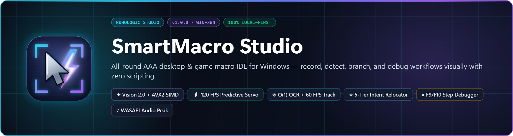
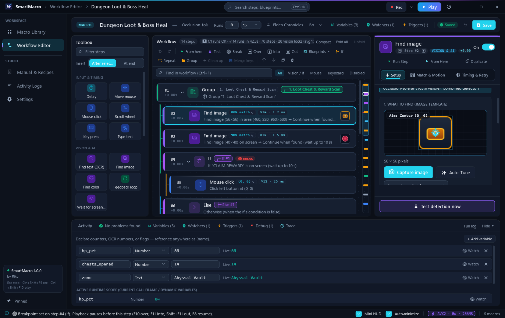
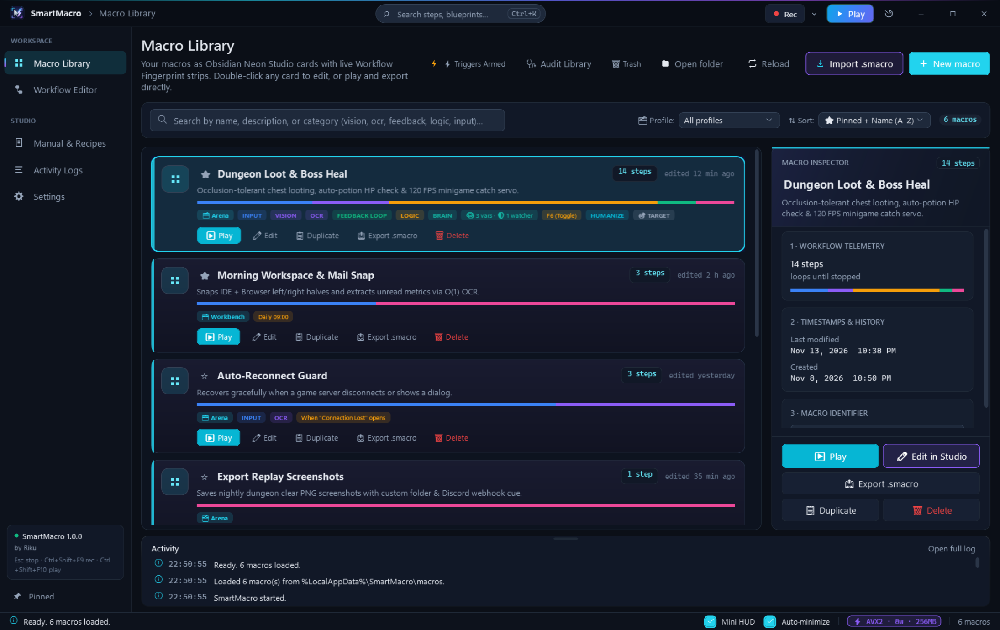
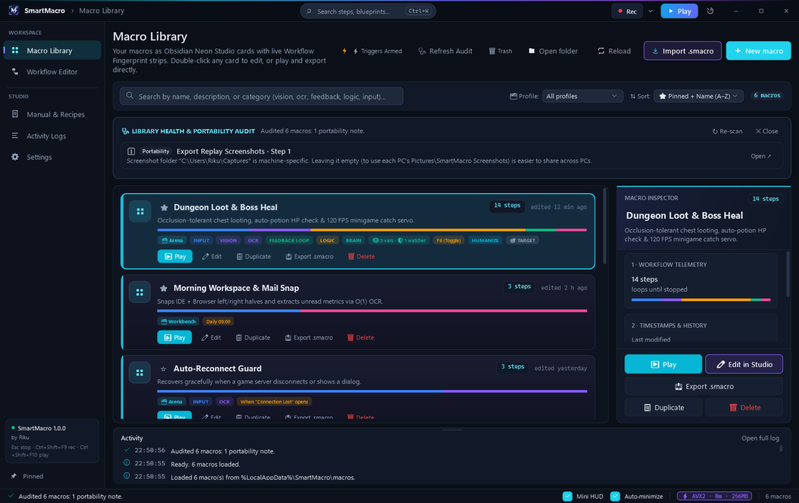
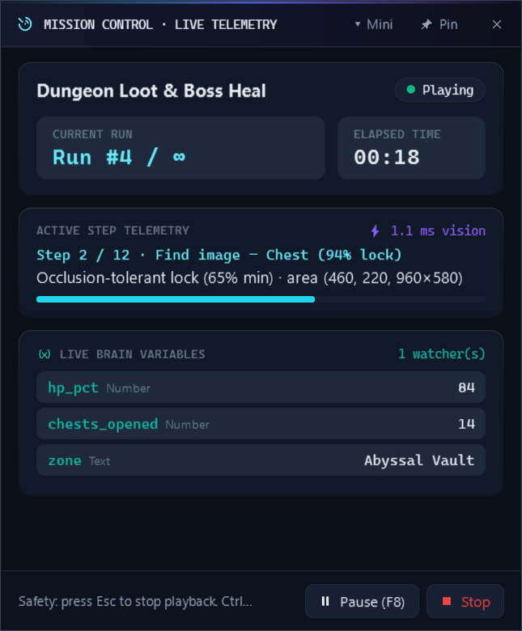
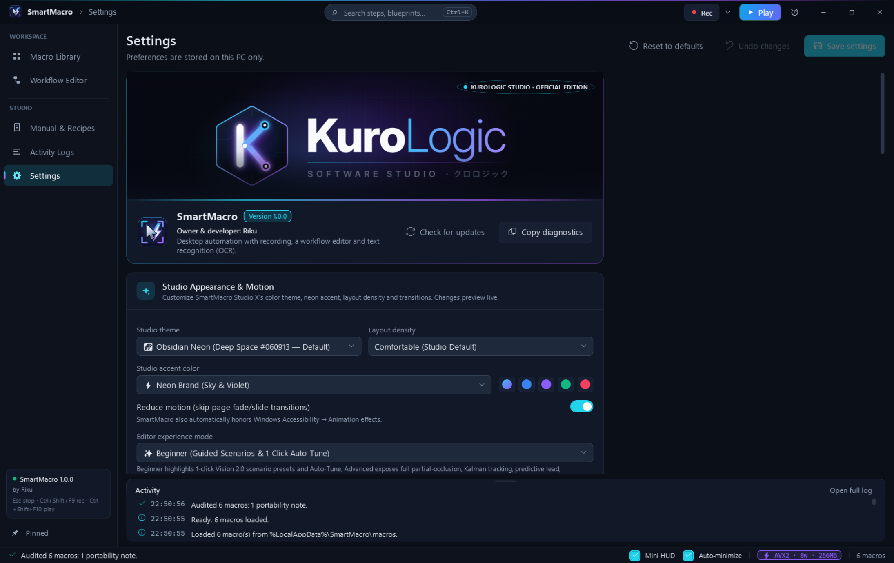
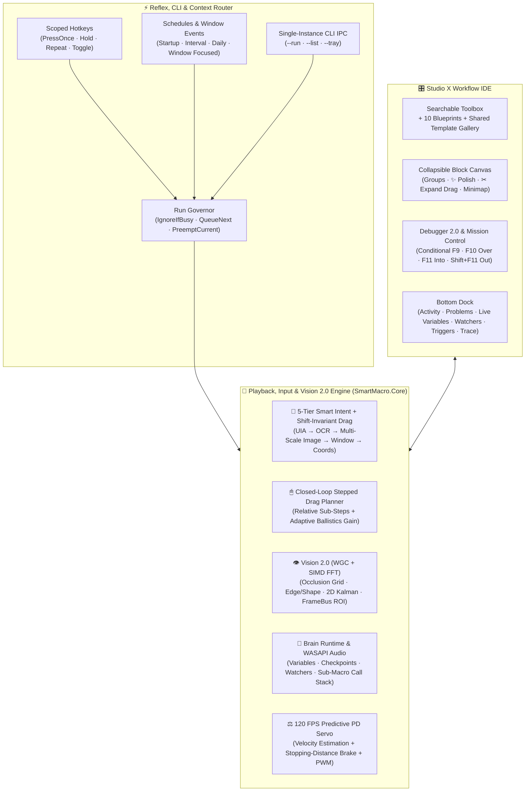

<div align="center">



<br />

[-0ea5e9?style=for-the-badge&logo=windows&logoColor=white)](https://github.com)
[](https://dotnet.microsoft.com)
[](https://github.com)
[](tools/verify.cmd)
[](#requirements--installation)

### **Record like a human. See like an AI. Debug like an IDE.**

**The local-first Windows automation studio built for both high-FPS gaming (*Arena*) and daily desktop power workflows (*Workbench*).**

Developer: **Riku (リク)** · Studio: **KuroLogic** · Built with `.NET 10` (`WPF`, `win-x64`)

[Why SmartMacro?](#why-smartmacro-studio) · [Visual Tour](#visual-tour) · [30-Second Quick Start](#30-second-quick-start) · [Superpowers](#core-superpowers) · [Architecture](#system-architecture) · [Shortcuts](#keyboard-shortcuts) · [Build & CLI](#requirements--installation)

</div>

---

## Why SmartMacro Studio?

Most macro tools force an annoying trade-off:
- **Tiny coordinate recorders** break the second a window moves 10 pixels, a loading spinner lags by half a second, or you try to drag a window across the screen.
- **Heavy scripting languages** make you write 150 lines of brittle boilerplate just to find an icon, read a number, and loop.

**SmartMacro Studio** gives you the best of both worlds — **one-click recording** that turns messy input into clean, visual workflow blocks, backed by **GPU screen capture**, **5-tier target relocation**, **120 FPS minigame physics**, and a **real call-stack debugger**.

<table>
  <tr>
    <td width="50%" valign="top">
      <h3>🎮 Mode 1: The Arena (Gaming & Minigames)</h3>
      <ul>
        <li><strong>Dual-Stream Recording:</strong> Seamlessly mixes 2D inventory/menu clicks with 3D locked-cursor camera turns (<code>WM_INPUT</code>) on a single sub-millisecond timeline.</li>
        <li><strong>120 FPS Predictive PD Servo:</strong> Stabilizes momentum/gravity minigame bars with real-time velocity estimation, stopping-distance braking, and PWM hover pulses.</li>
        <li><strong>Vision 2.0 + SIMD FFT:</strong> Spots moving or 40%-occluded targets through particle storms, tracks them with a 2D Kalman filter, and leads clicks ahead of motion.</li>
        <li><strong>Zero-Stuck-Key Guarantee:</strong> Physical <code>Esc</code> emergency stop + <code>HeldInputTracker</code> ensures no key or mouse button is ever left held down.</li>
      </ul>
    </td>
    <td width="50%" valign="top">
      <h3>💼 Mode 2: The Workbench (Desktop & Apps)</h3>
      <ul>
        <li><strong>🧭 5-Tier Smart Intent Relocator:</strong> Finds buttons even after windows move, resize, or change DPI (<code>UI Automation → OCR → Multi-Scale Image → Window Anchor → X/Y</code>).</li>
        <li><strong>Closed-Loop Window & UI Dragging:</strong> Moves Win32 title bars, WinUI 3 apps, WPF windows, and Chromium sliders smoothly — and shifts the entire drag trajectory if the window started in a new spot.</li>
        <li><strong>✨ 1-Click Workflow Polish:</strong> Merges raw keystrokes into editable <code>Type text</code> steps, structures drags into <code>Drag</code> or collapsible <code>Group</code> blocks, and folds redundant moves.</li>
        <li><strong>👻 Background Input & CLI:</strong> Click and type into background windows without stealing focus, or launch macros from Stream Deck / scripts via <code>--run</code>.</li>
      </ul>
    </td>
  </tr>
</table>

---

## Visual Tour

### 1. 3-Pane Workflow IDE, Vision 2.0 & Live Call-Stack Debugger

> Group long recordings into color-coded **`Group … End Group`** sections (`Ctrl+Shift+G`), polish raw recordings in 1 click (**`✨ Polish`**), set conditional breakpoints (`F9`), step into sub-macros (`F11`), and watch **Live Brain Variables** update in real time.

<p align="center">
  
</p>

### 2. Macro Library, Workflow Fingerprints & 1-Click Health Audit

<table>
  <tr>
    <td width="50%" valign="top">
      <a href="docs/images/studio-library.png">
        
      </a>
      <br />
      <strong>Obsidian Neon Library & Workflow Fingerprints</strong>
      <br />
      Filter routines by <em>Arena</em> or <em>Workbench</em> profile, see what each macro does at a glance via color-coded <strong>Workflow Fingerprint</strong> bars, and export self-contained <code>.smacro</code> bundles with deduplicated image assets.
    </td>
    <td width="50%" valign="top">
      <a href="docs/images/studio-audit.png">
        
      </a>
      <br />
      <strong>1-Click Library Health & Input Hygiene Audit</strong>
      <br />
      Scan your entire library in one click to catch broken sub-macro calls, recursive loops, hotkey collisions, unbalanced mouse-button holds, missing assets, or hardcoded paths — with instant jump-to-step fixes.
    </td>
  </tr>
</table>

### 3. Floating Mission Control (`Ctrl+M`) & Live Telemetry HUD

<table>
  <tr>
    <td width="40%" valign="top">
      <a href="docs/images/mission-control-hud.png">
        
      </a>
    </td>
    <td width="60%" valign="middle">
      <h3>Your Co-Pilot While Macros Run</h3>
      <ul>
        <li><strong>Full Telemetry Pod or Compact Mini-Bar:</strong> Keep the always-on-top HUD beside your game, or collapse it into a sleek pill bar that stays out of the way.</li>
        <li><strong>Sub-Millisecond Vision & Step Profiling:</strong> Watch current loop turn, elapsed time, live vision match confidence, and active step progress at 30 FPS UI refresh with zero playback lag.</li>
        <li><strong>Live Variable Watch & Instant Controls:</strong> Inspect runtime counters, OCR values, and audio peaks live — with <code>Pause (F8)</code> and <code>Emergency Stop (Esc)</code> always one tap away.</li>
      </ul>
    </td>
  </tr>
</table>

### 4. Studio Themes, Context Auto-Profiles & Hardware Acceleration

> Switch between **Obsidian Neon** and **Midnight Blue** themes, pick from 5 neon accents, configure **Foreground Window Auto-Profile Switching**, enable **Windows Graphics Capture (WGC)**, and manage automatic `.smbackup` archives.

<p align="center">
  
</p>

---

## 30-Second Quick Start

1. **Hit Record (`Ctrl+Shift+F9`):** Do your task naturally — click buttons, drag windows or sliders, type text, or turn a 3D game camera. Press `Ctrl+Shift+F9` again to stop.
2. **Click `✨ Polish` in the Editor:** SmartMacro automatically merges your typing into editable **Type text** steps, turns straight drags into smooth **Drag** steps, wraps multi-point drags into collapsible **Groups**, and cleans up redundant mouse paths.
3. **Play (`Ctrl+Shift+F10`) or Debug (`F9` / `F10` / `F11`):** Watch **Smart Intent** relocate targets even if you moved the window, or press `Ctrl+M` to monitor live telemetry from **Mission Control**.

---

## Core Superpowers

### 🧭 1. Dual-Stream Recording, Closed-Loop Dragging & 5-Tier Smart Intent
- **One Recorder for Everything:** Captures desktop cursor coordinates and raw hardware mouse deltas (`WM_INPUT`) on a single clock. Stationary duplicate moves are filtered without losing a microsecond of timing, and clicking an elevated (*Administrator*) window while running un-elevated triggers a proactive **UIPI warning**.
- **Closed-Loop Stepped Window & UI Drag Engine:** Dragging a Win32 title bar (`WM_NCLBUTTONDOWN` / `SC_MOVE`), WinUI 3 window (`InputNonClientPointerSource`), WPF `DragMove()` surface, or browser slider subdivides movement via `DragStepPlanner` into stepped, closed-loop relative `MOUSEEVENTF_MOVE` ticks with adaptive pointer-ballistics gain.
- **Window-Shift-Invariant Drag Replay:** When a drag's `Down` step relocates a moved window via **Smart Intent** or **Smart-Aim**, SmartMacro automatically translates all intermediate `MouseMove` waypoints and the final `Up` release by the exact same `(ShiftX, ShiftY)` offset.
- **The 5-Tier Smart Intent Relocator Chain:**
  | Tier | Strategy | What It Solves |
  | :---: | :--- | :--- |
  | **1** | **UI Automation (`UIA`)** | Finds controls by `AutomationId`, `Name`, and `ControlType` instantly — even if moved across monitors. |
  | **2** | **OCR Text Anchor** | Reads nearby label text via Windows OCR and applies the recorded pixel offset. |
  | **3** | **Multi-Scale Image (`75%–150%`)** | Matches the recorded `56×56` thumbnail across DPI and UI zoom changes. |
  | **4** | **Window-Relative Anchor** | Scales coordinates proportionally to the target app window's live position and size. |
  | **5** | **Recorded Coordinates** | Exact physical pixel `(X, Y)` fallback. |

### 👁 2. Vision Pipeline 2.0: SIMD FFT, Occlusion Grid, Kalman Tracking & Text/Color 2.0
- **Hardware-Accelerated Capture + SIMD FFT:** Combines **Windows Graphics Capture (`WGC`)** GPU frame pools and `BitBlt` with `Vector256<float>` AVX2/SSE2 radix-2 2D FFT cross-correlation and summed-area tables for ultra-fast template matching.
- **Partial-Visibility (Occlusion-Tolerant) Matching:** Splits templates into a `3×3` or `4×4` sub-patch grid (`MinVisiblePercent`) so targets still match when 30–40% covered by particles, damage numbers, or cursor tooltips.
- **Edge / Shape Matcher & Rotation Tolerance:** Sobel gradient-orientation contour matching (`EdgeShapeMatcher`) handles dramatic lighting shifts and `±0°–45°` rotation (`RotationRangeDeg`).
- **2D Kalman Tracker & Predictive Lead Clicks:** Estimates target velocity `(VelocityX, VelocityY)` in `px/s` across frames and leads clicks ahead of fast-moving targets (`PredictiveClick`, `PredictiveLeadMs`).
- **🔤 Text 2.0 (`O(1)` 1,000-Word Index + 60 FPS Visual Tracking):** Indexes 1,000+ screen words in `O(1)` with 64-bit character bitmask pre-filtering, regex support, Otsu/contrast preprocessing, and **Find-Once-Then-Track** (`TrackTextAsImage` crops the matched word and tracks it visually at 60 FPS without re-running OCR).
- **🎨 Color 2.0 (Perceptual CIE Lab $\Delta E$ / HSV & Shape Filtering):** Matches colors in `LabDeltaE`, `Hsv`, or `Rgb`, filters blobs by circularity (`MinCircularityPercent`) and fill density, and selects by `Largest`, `NearestToCenter`, `NearestToLastSpot`, or `TopMost`.

### ⚖️ 3. Smart Predictive Feedback Loop 2.0 (120 FPS Minigame Servo)
- **Adaptive PD Controller + Stopping-Distance Brake:** Tracks moving markers and catch zones at up to **120 FPS** (`FeedbackControlMode.SmartPredictive`), calculating coasting distance from live velocity to brake before overshooting.
- **Hover Pulse PWM & 1-Click Physics Presets:** Pick **🧲 Momentum Bar**, **⬇️ Gravity Bar**, **⚡ Snap Bar**, or **🍃 Floaty Bar**, or fine-tune lead time, deadzone, and PWM duty cycle for horizontal or vertical gauges.

### 🧠 4. Brain 2.0: Variables, WASAPI Audio Meter, Watchers & Sub-Macros
- **Typed Variables & Live Expressions:** Use `Number`, `Text`, and `Boolean` variables with math (`Set`, `Add`, `Subtract`, `Multiply`, `Divide`, `Modulo`, `Round`), string transforms (`Trim`, `ExtractDigits`, `UPPERCASE`, `lowercase`), and `{varName}` interpolation in any text or webhook field.
- **Rich Live Data Sources:** Read values from **Screen OCR numbers/text**, **📊 HUD bar/gauge fill % (`0–100%`)**, **🔊 System master audio peak % (`0–100%`)** via zero-dependency WASAPI, **🎲 Random numbers**, **🖥 Active window title**, **🕒 Current time**, **Clipboard**, **Last found X/Y**, or **📄 N-th line / CSV item**.
- **Checkpoints, Background Watchers & Sub-Macros:** Handle unexpected popups with periodic **Watchers**, recover from failures via **Retry / Jump to Checkpoint / Recovery Sub-Macro**, and extract any `Group` into a reusable sub-macro (`CallMacroStep`) with isolated call frames.

### ⚡ 5. Reflex & Context: Scoped Triggers, Run Governor, Background Input & CLI
- **Context-Scoped Triggers:** Bind **Hotkeys** (`PressOnce`, `HoldToRun`, `RepeatWhileHeld`, `Toggle`), **Schedules** (`OnStartup`, `Interval`, `DailyAt`), or **Window Events** (`WindowAppears`, `WindowFocused`) — optionally scoped to fire **only when a specific window title or process is active**.
- **Run Governor & Auto-Profiles:** Choose how overlapping triggers behave (`IgnoreIfBusy`, `QueueNext`, `PreemptCurrent`) and automatically switch active macro profiles when your foreground app or game changes.
- **👻 Background Input (`Win32 PostMessage` & `UI Automation`):** Send clicks, keystrokes, and text directly to background windows without moving your physical cursor or stealing focus.
- **Single-Instance CLI Automation:** Trigger macros from batch scripts, Task Scheduler, or Elgato Stream Deck:
  ```powershell
  # Run a macro by name or GUID (routes via Named Pipe IPC if SmartMacro Studio is already open)
  SmartMacro.exe --run "Daily Report Export"

  # List all macros and their IDs in the local library
  SmartMacro.exe --list

  # Launch SmartMacro silently into the Windows System Tray
  SmartMacro.exe --tray
  ```

---

## System Architecture



---

## Keyboard Shortcuts

| Shortcut | Action | Scope |
| :--- | :--- | :--- |
| `Ctrl+Shift+F9` *(customizable)* | Start / stop recording | Global (anywhere) |
| `Ctrl+Shift+F10` *(customizable)* | Play macro / stop playback | Global (anywhere) |
| `F8` *(customizable)* | Pause / resume playback (releases held keys while paused) | Global while playing |
| `Esc` | **Emergency Stop** (releases all held keys and mouse buttons immediately) | Global while playing |
| `F9` | Toggle debugger breakpoint on selected step (supports conditional expressions) | Editor |
| `F10` | **Step Over:** execute current step while paused and pause before the next | Editor / While paused |
| `F11` | **Step Into:** step into a called sub-macro (`CallMacroStep`) and inspect its frame | Editor / While paused |
| `Shift+F11` | **Step Out:** finish the current sub-macro frame and pause back at the caller | Editor / While paused |
| `Ctrl+T` | **Test Step:** test vision detection once (with near-miss score) or run action step once | Editor |
| `Ctrl+F5` | Play only the selected step (or entire `If` / `Repeat` / `Group` block) | Editor |
| `Shift+F5` | Play from the selected step to the end | Editor |
| `Ctrl+K` | Open **Command Palette** (search steps, blueprints, polish, auto-fix, speed…) | Studio |
| `Ctrl+M` | Toggle floating **Mission Control** live telemetry HUD window | Studio |
| `Ctrl+F` | Search steps in workflow (`F3` / `Shift+F3` next/previous match) | Editor |
| `Ctrl+S` | Save workflow | Editor |
| `Ctrl+Z` / `Ctrl+Y` | Structural Undo / Redo (`Ctrl+Shift+Z` also redoes) | Editor |
| `Ctrl+C` / `Ctrl+V` / `Ctrl+D` | Block-aware Copy / Paste / Duplicate (with in-app clipboard fallback) | Step list |
| `Space` | Enable / disable selected steps (or whole block) | Step list |
| `←` / `→` | Fold / unfold selected `If`, `Repeat`, or `Group` block | Step list |
| `Alt+↑` / `Alt+↓` | Block-aware move step up / down (`Alt+Home` / `Alt+End` for top / bottom) | Step list |
| `Ctrl+Shift+I` / `Ctrl+Shift+R` | Wrap selected steps in `If … End If` / `Repeat … End Repeat` | Step list |
| `Ctrl+Shift+G` | Wrap selected steps in a color-customizable `Group … End Group` | Step list |

---

## Requirements & Installation

- **OS:** Windows 10 version 2004 (Build 19041) or newer, or Windows 11 (`x64`).
- **OCR:** Uses the built-in Windows OCR engine (`Windows.Media.Ocr`). Check **Settings → Text recognition** in SmartMacro to verify your display language's OCR pack is installed.
- **Data Location & Portable Mode:** By default, macros, settings, logs, and crash diagnostics are stored locally in `%LOCALAPPDATA%\SmartMacro` (never inside the app folder, so updates never overwrite your library). For **Portable Mode** (USB drive or synced folder), create an empty `portable.txt` file or a `PortableData` folder next to `SmartMacro.exe`.

### Build, Verify & Package from Source

Requires the **.NET 10 SDK** on Windows:

```powershell
# Build with 0 warnings / 0 errors and run all 1,438 automated tests (Core + WPF/ViewModel)
cmd /c tools\verify.cmd

# Run tests, publish a self-contained single-file win-x64 EXE, verify third-party notices, and create the release ZIP
cmd /c tools\publish.cmd
```

---

## Safety & Honest Limits

- **Emergency Stop & Stuck-Key Failsafe:** Pressing physical `Esc` stops playback immediately. Every key and mouse button pressed by SmartMacro is tracked in `HeldInputTracker` and released when playback finishes, stops, pauses, or encounters an error.
- **Administrator Apps (UIPI):** Windows blocks non-elevated processes from sending input to elevated (*Run as Administrator*) windows, the lock screen, or UAC prompts. SmartMacro detects elevated target windows during recording and warns you; run SmartMacro as Administrator when automating elevated apps.
- **Exclusive Fullscreen:** Desktop screen capture sees black in exclusive fullscreen games; switch the game to **Borderless Windowed** or **Windowed** mode for vision steps.
- **Fair Play & Anti-Cheat:** SmartMacro uses standard Windows APIs (`SendInput`, `Windows.Graphics.Capture`, `BitBlt`, `Windows.Media.Ocr`, `UIAutomation`) and never reads or modifies process memory or attempts to bypass anti-cheat software.

---

## Community & Support

- **Discord (Official Downloads, Bug Reports & Feedback):** https://discord.gg/CKBk5KnGmk
- **YouTube:** https://www.youtube.com/@KuroLogic039
- **Ko-fi (Optional Support):** https://ko-fi.com/sakurariku

© 2026 Riku · KuroLogic. All rights reserved.
