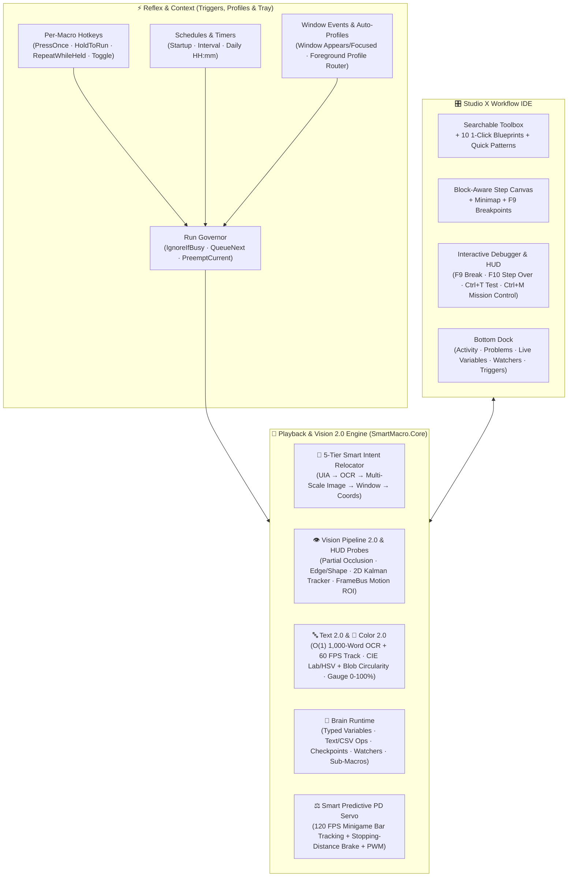

# SmartMacro Studio

**All-round AAA desktop & game macro studio for Windows — record, build, debug, and automate workflows visually.**

Developer: **Riku (リク)** · Brand: **KuroLogic** · Version **1.0.0** · `.NET 10` (WPF, `win-x64`)

SmartMacro is a local-first Windows automation studio built for both **daily productivity ("Workbench")** and **high-FPS gaming ("Arena")**. It records mouse and keyboard input across desktop apps and 3D games, converts recordings into structured visual workflows, and combines **Vision Pipeline 2.0** (occlusion-tolerant template matching, edge/shape gradients, 2D velocity tracking with predictive lead clicks, 1,000-word O(1) OCR + 60 FPS visual word tracking, perceptual CIE Lab/HSV color & shape filtering, and HUD gauge % reading), **Smart Predictive PD Feedback Servos**, compound `AND`/`OR` branching logic, typed variables (with full math, random ranges, active window title, clock, and zero-dependency WASAPI system audio peak detection), synthesized WAV sound cues, Blackbox failure snapshots, background watchers, per-macro triggers, 1-click `.smbackup` Studio archives, and an interactive step debugger — all with **zero scripting required** and **zero cloud uploads**.

---

## System Architecture



---

## Key Capabilities

### 1. 👁 Vision Pipeline 2.0: Moving Targets, Heavy Particles, Text 2.0 & Color 2.0
- **Partial-Visibility (Occlusion-Tolerant) Image Matching:** Splits templates into a `3×3` or `4×4` sub-patch grid and scores the unoccluded cells (`MinVisiblePercent`), reliably matching targets even when 30–40% covered by particles, hit flashes, or floating damage numbers.
- **Edge / Shape Gradient Detector & Rotation Tolerance:** Sobel gradient-orientation contour matching (`EdgeShapeMatcher`) stays invariant under severe lighting or color tint changes, with optional `±0°–45°` rotation tolerance (`RotationRangeDeg`).
- **2D Kalman / Alpha-Beta Target Tracker & Predictive Lead Clicks:** Tracks moving targets across frames (`TargetTracker`), estimates 2D velocity `(VelocityX, VelocityY)` in `px/s`, dynamically expands the search ROI along the trajectory, and leads clicks ahead of moving targets (`PredictiveClick`, `PredictiveLeadMs`).
- **Temporal N-Frame Confirmation & Motion-Gated ROI (`FrameBus`):** `ConfirmFrames` (`2..10`) rejects 1-frame particle flashes; `OnlyWhereMoved` uses a thread-safe `16×16` grid motion mask to scan only screen regions that changed, plus `< 1 ms` Hot-Spot ROI caching.
- **🔤 Text 2.0 (1,000-Word O(1) Index & Find-Once-Then-Track):**
  - Instant `O(1)` hash-table lookup for single-word queries across 1,000+ words on screen, 64-bit character bitmask pre-filtering before fuzzy Levenshtein matching, and regex pattern support (`UseRegexPattern`).
  - **Find-Once-Then-Track (`TrackTextAsImage`):** Once OCR locates a target word among shuffling text, SmartMacro crops its live bounding box and tracks it visually at 60 FPS (`~1–3 ms`) without re-running OCR on every frame.
  - Built-in **OCR Image Preprocessor** (`Auto`, `HighContrast`, `InvertLightOnDark`, `BinarizeOtsu`).
- **🎨 Color 2.0 (Perceptual CIE Lab / HSV & Blob Shape Filtering):** Match colors in `LabDeltaE` ($\Delta E$), `Hsv`, or `Rgb` space, filter blobs by circularity (`MinCircularityPercent` to distinguish round orbs from thin particle streaks), fill ratio, and pixel area, and select by `Largest`, `NearestToCenter`, `NearestToLastSpot`, or `TopMost`.
- **✨ 1-Click Scenario Presets & Live Auto-Tune:** Choose beginner-friendly presets (`Static UI`, `Game HUD`, `Moving Target`, `Busy Particles`, `Scrolling Text`, `Fast Reaction`) or run **Auto-Tune** (`TemplateAutoTuner`) to sample the live screen and configure optimal thresholds automatically.

### 2. ⚖️ Smart Predictive Feedback Loop 2.0 (High-FPS Minigame Servo)
- **Adaptive PD Controller + Stopping-Distance Brake:** Tracks moving targets and catch zones up to **120 FPS** (`FeedbackControlMode.SmartPredictive`), predicting coasting distance from live bar velocity and braking before overshoot.
- **Hover Pulse PWM & 4 Behavior Cards:** Choose 1-click tuning cards (**🧲 Momentum Bar**, **⬇️ Gravity Bar**, **⚡ Snap Bar**, **🍃 Floaty Bar**) or fine-tune lead prediction, deadzone, and PWM duty cycle for horizontal or vertical minigame bars.

### 3. 🧭 Smart Dual-Stream Recording & 5-Tier Intent Relocator
- **One Record Button for Apps and 3D Games:** Captures screen coordinates and raw relative mouse deltas (`WM_INPUT`) on a single high-precision timeline. Free-cursor segments become editable **Move / Click / Key / Delay** steps; locked/hidden-cursor camera turns become **Recorded input** steps with automatic stuck-key protection and smooth catch-up debt limiting.
- **5-Tier Resilient Target Relocator:** With **Intent Recording** enabled, recorded clicks capture a multi-anchor `TargetFingerprint` off-thread (never slowing down mouse hooks) and relocate automatically when windows move or resize:
  1. **UI Automation element** (`AutomationId`, `Name`, `ControlType`, normalized interior click point — with single-flight protection against hung apps)
  2. **Nearby OCR text anchor** + pixel offset
  3. **56×56 Image Snapshot** (1:1 fast path + **75%–150% multi-scale pyramid** for DPI/zoom changes)
  4. **Window-Relative coordinate anchor** (window title + process name)
  5. **Recorded coordinates fallback**
- **🔧 Opt-In Smart Self-Heal:** When playback relocates a drifted click by `≥ 25 px`, the editor offers a 1-click banner to update the step's coordinates (`Ctrl+Z` undoes it; macros are never rewritten silently).
- **⏱ Adaptive Timing & 🎲 Humanize:** Delay steps can wait a fixed duration, **✨ Until screen settles** (continues early once loading animations stop), or **⚡ Until screen changes** (continues the instant new pixels appear). Optional **Humanize** adds subtle bounded click jitter, natural delay variation, and curved mouse glides.

### 4. 🧠 Brain 2.0: Variables, WASAPI Audio Meter, Compound Logic, Checkpoints, Watchers & Sub-Macros
- **Typed Variables, Full Math & `{placeholders}`:** Declare `Number`, `Text`, or `Boolean` variables with live runtime inspection in the bottom dock. Supports `Set`, `Add`, `Subtract`, `Multiply` (`×=`), `Divide` (`÷=`), `Modulo` (`%=`), `Round`, and text cleanup (`Trim`, `ExtractDigits`, `UPPERCASE`, `lowercase`), plus optional 1-click copy to the Windows clipboard (`CopyResultToClipboard`). Use `{varName}` inside **Type text**, **Find text**, **Focus window**, or **Screenshot** steps.
- **Screen, HUD Gauge, System Audio & List Data Sources:** Read values from constants, **🔢 Read number on screen (OCR)**, **Read text on screen**, **📊 Read bar / gauge fill % (`0–100%`)** (supports `LeftToRight`, `RightToLeft`, `BottomToTop`, `TopToBottom` with automatic centered-text filtering and `RelativeRect` scaling across `1080p` / `1440p` / `4K`), **🔊 System master audio peak % (`0–100%`)** via zero-dependency WASAPI (react to game audio cues, fish-bite splashes, or silence), **🎲 Random integer (`min..max`)**, **🖥 Active foreground window title**, **🕒 Current date/time text**, **Clipboard**, **Last found X/Y**, **Loop counter**, **Elapsed seconds**, or **📄 N-th line / CSV item (at loop turn)**.
- **➕ Compound Conditions (`AND` / `OR`):** Combine a second condition (`Text`, `Image`, `Color`, or `Variable value`) using **AND** or **OR** inside any `If` or `Repeat` (`While` / `Until`) block.
- **Workbench Text Cleanup & Window Snap:** Transform text variables and snap target windows (`SnapLeftHalf`, `SnapRightHalf`, `Maximize`, `CenterOnPrimary`) via **Focus window**.
- **📍 Checkpoints, Failure Policies & 🛡 Background Watchers:** On any vision search or window focus timeout, choose to **Continue**, **Skip next step**, **Stop**, **🔁 Retry (`N` attempts)**, **🛡 Run a recovery sub-macro**, or **📍 Jump back to a Checkpoint** (capped at 25 restarts per run). Periodic **Background Watchers** guard against surprise popups between steps.
- **📦 Sub-Macros & Self-Contained `.smacro` Bundles:** Call reusable library macros with isolated variable scopes, Input/Output bindings, and cycle detection. Exporting a macro automatically bundles all transitive sub-macros into one portable `.smacro` file.

### 5. ⚡ Reflex & 🗂 Context: Triggers, Run Governor, Profiles & System Tray
- **Per-Macro Triggers:** Attach hotkeys (**Press once**, **Hold to run**, **Repeat while held**, **Toggle**), **Schedules** (**On startup**, **Every N minutes/seconds**, **Daily at `HH:mm`**), or **🖥 Window Events** (**Window opened / focused**) to any macro.
- **Run Governor & Master Armed Switch:** Configure per-trigger conflict rules (**Ignore if busy**, **Queue next** up to 8 runs, or **Preempt & stop current**) and toggle all background triggers with the top-bar **⚡ Triggers Armed** switch.
- **Profiles, System Tray & Launch on Windows Startup:** Tag macros by profile and enable **Auto-switch active profile from foreground window** so game/app triggers only fire when their target window is active. Enable **Minimize to system tray on close** and **Start SmartMacro with Windows (minimized to system tray)** (`--tray`) for hands-free background automation.

### 6. 🎛 Studio X & Evergreen Reliability: IDE, Debugger, Blackbox Recorder & Studio Backups
- **3-Pane Studio Workspace & Library Organization:** Custom 40px `WindowChrome` header with Windows 11 Mica-Alt backdrop, searchable Toolbox (`Beginner` / `Advanced` modes, 10 1-Click Blueprints, and Quick Patterns), block-indented Workflow Canvas with color-coded guide rails and right-edge **Workflow Minimap**, sticky **Inspector**, collapsible **Bottom Dock**, and `Ctrl+K` **Command Palette**. Pin favorite macros (`⭐`) to the top of the Library and sort by `Pinned + Name (A–Z)`, `Recently Modified`, `Recently Created`, or `Most Steps`.
- **🔴 Interactive Step Debugger (`F9` / `F10`), Per-Step Profiler & 🧪 Instant Vision Test (`Ctrl+T`):**
  - Toggle **`F9`** breakpoints on any step; playback pauses before executing the step and safely releases held keys/buttons.
  - Inspect live variables, press **`F10`** (**Step Over**) to execute one step at a time, or press **`Ctrl+T`** to test any vision step against the live screen with target-lock reticle feedback and near-miss similarity scores.
  - After playback, step cards display **per-step execution count and average duration badges** (`×N · X ms`) so you can spot slow steps at a glance.
- **🔍 Blackbox Flight Recorder, Sound Cues & Webhooks:**
  - When a vision or `Wait for screen change` step times out and stops the macro, SmartMacro automatically saves the exact failure frame (`last-failure-snapshot.png`) and shows a 1-click **🔍 View Failure Snapshot** banner in the Editor.
  - **Take screenshot** steps can play built-in synthesized WAV sound cues (`SuccessChime`, `SoftBell`, `DoubleBeep`), log `{variable}`-interpolated messages, and post rate-limited HTTPS webhooks (Discord / Slack).
- **📦 Evergreen Self-Service (Trash Drawer, `.smbackup` Archives, Portable Mode & Auto-Pruning):**
  - Restore accidentally deleted macros directly from the in-app **🗑 Trash** drawer in the Library.
  - Export and restore your entire Studio library and settings in 1 click as a `.smbackup` ZIP archive in **Settings → Backup, Maintenance & Updates**.
  - Automatic 30-day retention pruning keeps `Logs/` and `Trash/` clean automatically.
- **🛸 Floating Mission Control (`Ctrl+M`) & Live Themes:** Open the compact always-on-top Mission Control overlay for live transport controls and telemetry, and customize Studio appearance across `Obsidian Neon` / `Midnight Blue` themes, 5 accent colors, and `Comfortable` / `Compact` density.

---

## Keyboard Shortcuts

| Shortcut | Action | Scope |
| :--- | :--- | :--- |
| `Ctrl+Shift+F9` *(customizable)* | Start / stop recording | Global (anywhere) |
| `Ctrl+Shift+F10` *(customizable)* | Play macro / stop playback | Global (anywhere) |
| `F8` *(customizable)* | Pause / resume playback (releases held keys while paused) | Global while playing |
| `Esc` | Emergency stop (releases all held keys and buttons immediately) | Global while playing |
| `F9` | 🔴 Toggle debugger breakpoint on selected step | Editor |
| `F10` | ⏭ Step over: run one step while paused and pause before the next | Editor / While paused |
| `Ctrl+T` | 🧪 Test Step: test vision detection once (with near-miss score) or run action step once | Editor |
| `Ctrl+F5` | ▶ Run step: play only the selected step (or whole `If` / `Repeat` block) | Editor |
| `Shift+F5` | ⏭ Play from the selected step to the end | Editor |
| `Ctrl+K` | Open Command Palette (add steps, blueprints, play, auto-fix, speed…) | Editor |
| `Ctrl+M` | Toggle floating Mission Control mini-HUD window | Studio |
| `Ctrl+F` | Search steps in workflow (`F3` / `Shift+F3` next/previous match) | Editor |
| `Ctrl+S` | Save workflow | Editor |
| `Ctrl+Z` / `Ctrl+Y` | Undo / Redo (`Ctrl+Shift+Z` also redoes) | Editor |
| `Ctrl+C` / `Ctrl+V` / `Ctrl+D` | Block-aware Copy / Paste / Duplicate | Step list |
| `Space` | Enable / disable selected steps (or whole `If` / `Repeat` block) | Step list |
| `←` / `→` | Fold / unfold selected `If` / `Repeat` block | Step list |
| `Alt+↑` / `Alt+↓` | Block-aware move step up / down (`Alt+Home` / `Alt+End` for top / bottom) | Step list |
| `Ctrl+Shift+I` / `Ctrl+Shift+R` | Wrap selected steps in `If … End If` / `Repeat … End Repeat` | Step list |

---

## Requirements & Installation

- **OS:** Windows 10 version 2004 (May 2020 Update, build 19041) or newer, or Windows 11 (`x64`).
- **OCR:** Uses the built-in Windows OCR engine (`Windows.Media.Ocr`). Check **Settings → Text recognition** in SmartMacro to verify your display language's OCR pack is installed.
- **Data location & Portable Mode:** By default, macros, settings, logs, and crash diagnostics are stored locally in `%LOCALAPPDATA%\SmartMacro` (never inside the application folder, so updating preserves your library). To run in **Portable Mode** (for a USB drive or synced folder), create an empty `portable.txt` file or a `PortableData` folder next to `SmartMacro.exe`.

### Build, Verify & Package from Source

Requires the **.NET 10 SDK** on Windows:

```powershell
# Build with 0 warnings / 0 errors and run all 1,284 unit tests (logs written to artifacts\build.log & artifacts\test.log)
cmd /c tools\verify.cmd

# Run tests, publish a self-contained single-file win-x64 EXE, verify third-party notices, and create the release ZIP
cmd /c tools\publish.cmd
```

---

## Safety & Honest Limits

- **Emergency Stop & Stuck-Key Failsafe:** Pressing physical `Esc` stops playback immediately. Every key and mouse button pressed by SmartMacro is tracked in `HeldInputTracker` and released when playback finishes, stops, pauses, or if an error occurs.
- **Administrator Apps (UIPI):** Windows blocks non-elevated processes from sending input to elevated (Run as Administrator) windows, the lock screen, or UAC prompts. Run SmartMacro as Administrator if your target game or app runs as Administrator.
- **Exclusive Fullscreen:** Desktop screen capture sees black in exclusive fullscreen games; switch the game to **Borderless Windowed** or **Windowed** mode for vision steps.
- **Anti-Cheat:** SmartMacro uses standard Win32 input and screen capture APIs (`SendInput`, `BitBlt`, `Windows.Media.Ocr`, `UIAutomation`) and never reads or modifies game memory or attempts to bypass anti-cheat software.

---

## Community & Support

- **Discord (Official Downloads, Bug Reports & Feedback):** https://discord.gg/CKBk5KnGmk
- **YouTube:** https://www.youtube.com/@KuroLogic039
- **Ko-fi (Optional Support):** https://ko-fi.com/sakurariku

© 2026 Riku · KuroLogic. All rights reserved.
